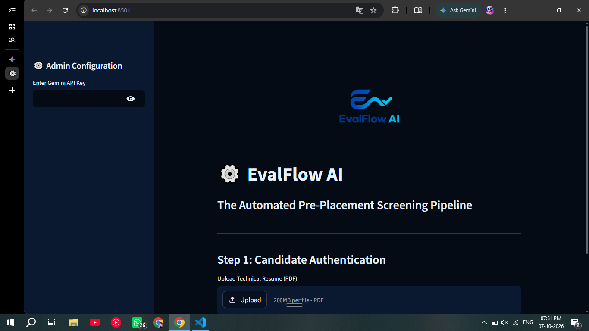
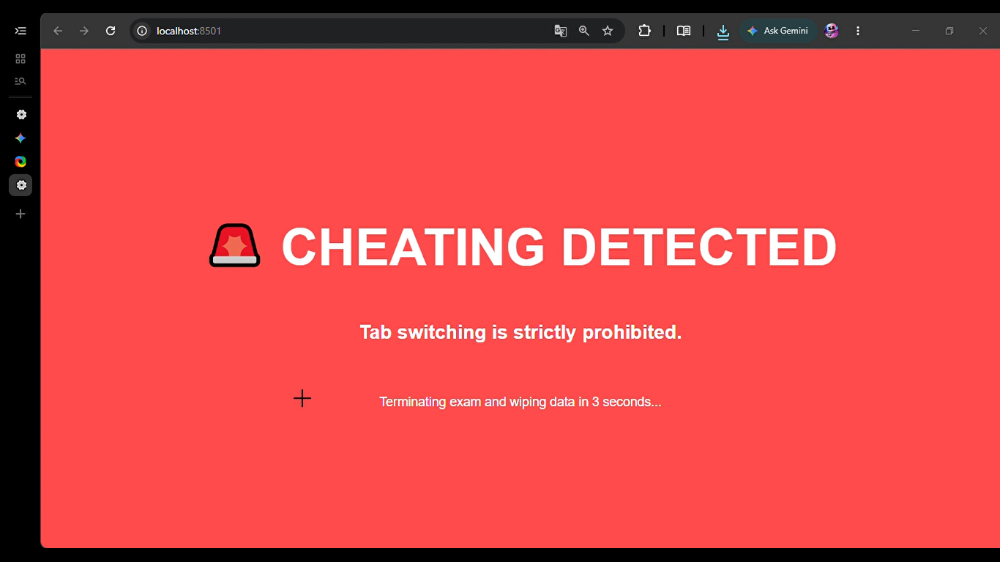
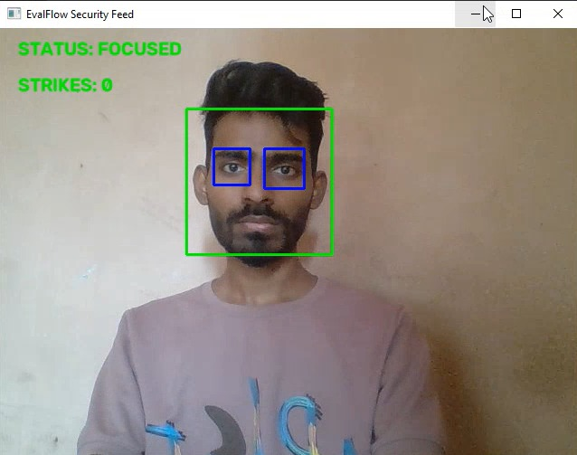
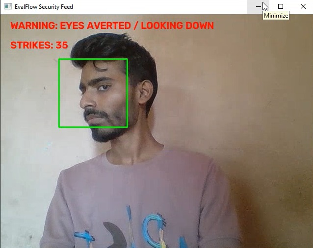
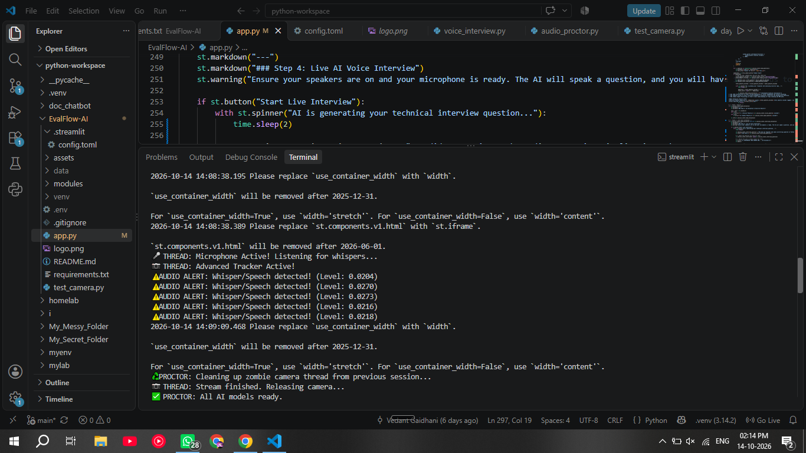

# ⚙️ EvalFlow AI: Automated Pre-Placement Screening & Proctoring Pipeline

**EvalFlow AI** is an end-to-end technical screening application designed to automate initial campus placement rounds. It parses candidate resumes, generates custom technical assessments, enforces multi-threaded hardware proctoring (vision, audio, and browser DOM lock), and conducts an automated live voice interview.

---

## 🖥️ System Interface & Architecture



### Core Pipeline Stages:
1. **Dynamic Resume Parsing (`PyPDF2` + `Gemini API`):** Extracts core technical competencies from uploaded PDF resumes and dynamically compiles role-specific assessment questions.
2. **Browser DOM Anti-Cheat Lock (`JavaScript Injection`):** Injects a `visibilitychange` event listener directly into the parent browser DOM (`window.parent.document`). Switching tabs or minimizing the browser triggers an immediate UI lock and wipes the active session state.
3. **Multi-Threaded Vision & Audio Proctoring (`OpenCV` + `SoundDevice`):** Runs background daemon threads during the exam to monitor candidate presence and ambient audio levels without blocking the Streamlit event loop.
4. **Algorithmic Grading & Live Voice Interview (`pyttsx3` + `SpeechRecognition`):** Deducts logged security penalty seconds from the base technical evaluation (-1 point per 5 penalty seconds) before launching a 10-second live spoken technical interview.

---

## 🛡️ Security & Proctoring Engine in Action

### 1. DOM-Level Tab-Switch Termination
If a candidate attempts to switch tabs or open an external application during the assessment, the injected script escapes the Streamlit component iframe and terminates the session:



### 2. Real-Time Vision Tracking (Haar Cascades)
Background daemon threads track facial and ocular presence in real time. Looking away from the screen increments the candidate's vision penalty counter:

| Verified Presence (0s Penalty) | Absence Detected (Penalty Incrementing) |
| :---: | :---: |
|  |  |

### 3. Continuous Audio Proctoring (RMS Signal Processing)
Monitors ambient noise and background whispers using Root Mean Square (RMS) amplitude math over raw `NumPy` audio streams:



---

## 🔧 Key Engineering Challenges Solved

* **Bypassing Native C++ Audio Compilation (`PyAudio` Bottleneck):** Standard Python voice pipelines often fail on Windows environments due to missing C++ build tools required by `PyAudio`. Engineered a custom audio capture pipeline using `sounddevice` to record raw microphone streams as `NumPy` arrays and serialized them into `.wav` buffers via `scipy.io.wavfile` for `SpeechRecognition`.
* **Escaping Streamlit's Sandboxed Iframe:** Streamlit renders custom HTML/JS inside an isolated iframe, preventing standard scripts from reloading the main app. Resolved this by attaching the event listener and `location.reload()` timer directly to `window.parent`.
* **Non-Blocking Hardware Daemons:** Designed the OpenCV webcam loop and SoundDevice microphone listener as isolated Python `threading.Thread` daemons so continuous hardware polling never freezes the web UI.

---

## 🚀 Local Setup & Installation

1. **Clone the repository:**
   ```bash
   git clone [https://https://github.com/vedgaidhani/evalflow-ai.git](https://https://github.com/vedgaidhani/evalflow-ai.git)
   cd EvalFlow-AI
2. **Install dependencies:**
Bash
pip install -r requirements.txt

3. **Run the application:**
Bash
streamlit run app.py

4. **Enter your Google Gemini API Key in the configuration sidebar and upload any technical resume in PDF format to begin the pipeline.**

## 📄 License
** Distributed under the MIT License. See LICENSE for more information
